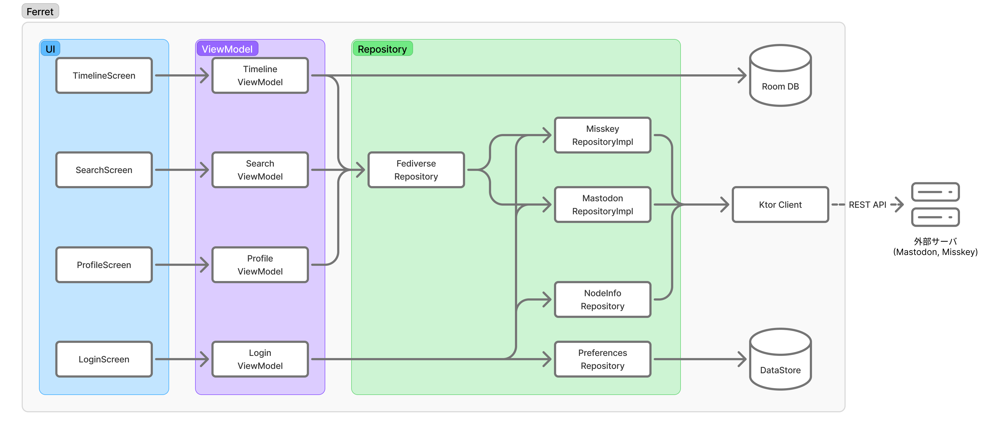

# Ferret

[](https://github.com/lag129/Ferret/blob/main/LICENSE)
[](https://developer.android.com/tools/releases/platforms?hl=ja#11)
[](https://github.com/lag129/Ferret/actions)

Ferret は Android向けの軽量な [Mastodon](https://joinmastodon.org/)
クライアントアプリです。一部の機能では [Misskey](https://misskey-hub.net/) の操作にも対応しています。

## 実装機能

- タイムラインの表示 (Mastodon / Misskey)
- プロフィールの表示 (Mastodon / Misskey)
- カスタム絵文字の表示 (Mastodon)
- 検索機能 (Mastodon)
- OAuth 対応

## 使用技術

| 分類           | 技術                        |
|:---------------|-----------------------------|
| 言語           | Kotlin                      |
| UI             | Jetpack Compose, Material 3 |
| 画面遷移       | Navigation 3                |
| DI             | Koin                        |
| HTTP 通信      | Ktor                        |
| データ永続化   | Room, DataStore             |
| 画像表示       | Coil 3                      |
| HTML 解析      | Ksoup                       |
| パフォーマンス | Baseline Profile            |
| テスト         | Kotest, MockK               |

## ディレクトリ構成

```
.
├── app/
│   ├── schemas/
│   └── src/
│       ├── main/java/net/lag129/ferret/
│       │   ├── db/                 # Entity, DAO
│       │   ├── model/
│       │   │   ├── converter/
│       │   │   ├── mastodon/       # Mastodon API モデル
│       │   │   └── misskey/        # Misskey API モデル
│       │   ├── repository/         # リポジトリ
│       │   ├── ui/
│       │   │   ├── compose/        # コンポーザブル
│       │   │   ├── navigation/     # Navigation Display
│       │   │   ├── screen/         # 各UI画面
│       │   │   └── theme/
│       │   └── utils/              # HTML パーサ, Emoji パーサなど
│       ├── test/
│       └── androidTest/
└── baselineprofile/
```

## アーキテクチャ概要図



## ライセンス

[MIT license](https://github.com/lag129/Ferret/blob/main/LICENSE)
