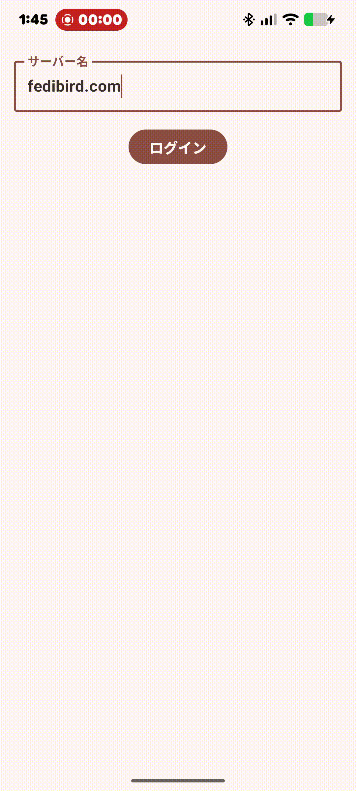
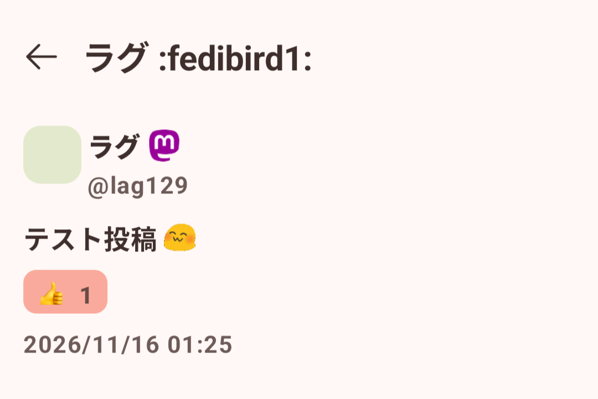
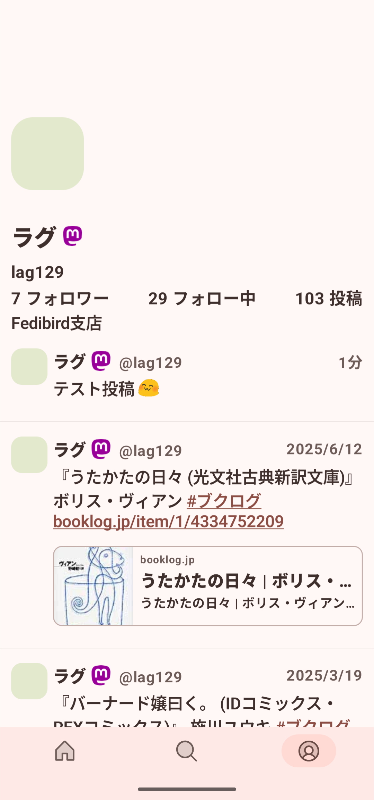

# 機能概要 (Mastodon)

## ログイン処理

- OAuth でのログイン機能を実装
- 認証の流れ
    1. `/api/v1/apps` にクライアントアプリを登録する
    2. ブラウザで `/oauth/authorize` を開き、ユーザが認可する
    3. 認可コードを受け取り、`/oauth/token` でアクセストークンを取得する
- 取得したアクセストークン, サーバ名は DataStore に保存する
- 次回アプリ起動時はログイン済みとしてホーム画面を表示する

## タイムライン画面

- 画面上部のバーから、ホーム / ローカル / 連合の 3 種類のタイムラインを切り替えられる

| タイムライン | Mastodon                              |
|:-------------|:--------------------------------------|  
| ホーム       | `/api/v1/timelines/home`              |
| ローカル     | `/api/v1/timelines/public?local=true` |
| 連合         | `/api/v1/timelines/public`            |

- 投稿を 20 件ずつ取得し、リストの末尾までスクロールしたとき続きを読み込む
- Pull to Refresh で、新着の投稿をリストの先頭に追加する
- 取得したタイムラインは種類ごとに Room へキャッシュし、タイムライン切り替え時にキャッシュを表示する

## 投稿の詳細画面

- タイムラインの投稿をタップすると投稿内容の詳細画面が表示される
- 画像やリンクカード、リアクション、投稿日時を表示する

### 絵文字の表示

- 絵文字
    - Mastodon では、サーバ独自の絵文字を `:smile:` のようなショートコードで本文中に埋め込める
- 絵文字が含まれた投稿本文から HTML をパースした後、ショートコードを抽出する
- `AnnotatedString` を使用して、文字と画像を同じコンポーネント内で表示する

### リアクションの表示

- リアクション
    - Mastodon の一部のサーバでは、投稿内容に対して絵文字でリアクションができる
- 投稿内容についたリアクションを一覧で表示する

## プロフィール画面

- 投稿のアイコンや表示名をタップしたとき、ユーザのプロフィールを表示する
    - アカウント情報や投稿の一覧

## 検索機能

- 画面下部のバーから検索画面を開き、キーワードを入力して投稿を検索する
- 検索結果は投稿のみを最大 20 件表示する

## 設定

- タイムライン画面上部のボタンから設定画面を開ける
- 「アプリについて」と「ライセンス」の画面を表示できる
